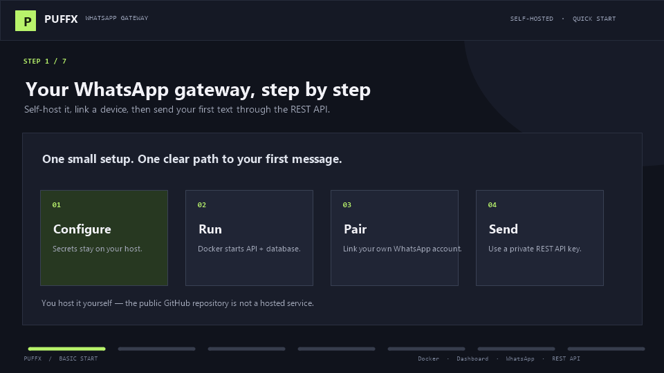

# Puffx WhatsApp Gateway

Self-hosted WhatsApp messaging gateway with a web dashboard, REST API, PostgreSQL, and QR or phone pairing. You run it on your own computer or server; this GitHub repository does not provide a hosted gateway.

> **Status:** Initial beta implementation. It supports pairing a WhatsApp Web account and sending text messages. Baileys is an unofficial WhatsApp Web integration, not the official WhatsApp Business Platform. Real WhatsApp pairing and delivery behavior depend on WhatsApp and were not verified by automated tests. Review [security and limitations](docs/security.md) before exposing an instance publicly.



## What you need

- Docker Engine and Docker Compose (recommended), or Node.js 20.19+, npm, and PostgreSQL 14+.
- For a public server: a domain, HTTPS reverse proxy, persistent storage, and outbound WebSocket access.
- A WhatsApp account that you can pair using **Linked devices**.

## Run with Docker

This is the quickest way to start locally. First install and start Docker Desktop, then in **Windows Command Prompt (CMD)** run:

```bat
git clone https://github.com/puffxhost/puffx-whatsapp-gateway.git
cd puffx-whatsapp-gateway
setup-windows.cmd
```

The helper copies `.env.example` to `.env` on first run, opens it in Notepad so you can replace the three sample secrets (`POSTGRES_PASSWORD`, `SESSION_SECRET`, and `API_KEY_PEPPER`), then starts the database and gateway. Save and close Notepad to continue. Keep `.env` private. Once setup finishes, open [http://127.0.0.1:3000](http://127.0.0.1:3000). Docker Desktop must be running. You can also run the commands manually in CMD:

```bat
git clone https://github.com/puffxhost/puffx-whatsapp-gateway.git
cd puffx-whatsapp-gateway
copy .env.example .env
notepad .env
docker compose up -d --build
```

Replace the three sample secrets in Notepad before starting Docker Compose.

In PowerShell:

```powershell
git clone https://github.com/puffxhost/puffx-whatsapp-gateway.git
Set-Location puffx-whatsapp-gateway
Copy-Item .env.example .env
```

On Linux or macOS:

```sh
git clone https://github.com/puffxhost/puffx-whatsapp-gateway.git
cd puffx-whatsapp-gateway
cp .env.example .env
```

Edit `.env` and replace `POSTGRES_PASSWORD`, `SESSION_SECRET`, and `API_KEY_PEPPER` with unique random values. For example, generate a value with `openssl rand -hex 32` where OpenSSL is installed. Keep the two application secrets different and never commit `.env`.

Start the gateway:

```sh
docker compose up -d --build
```

Open [http://127.0.0.1:3000](http://127.0.0.1:3000). Check that [http://127.0.0.1:3000/api/v1/ready](http://127.0.0.1:3000/api/v1/ready) reports `ready`. Docker Compose persists the database and WhatsApp login state in named volumes.

To stop it while keeping data:

```sh
docker compose down
```

To remove the database and WhatsApp login data as well (destructive):

```sh
docker compose down -v
```

## Publish and use the Docker Hub image

The project includes a GitHub Actions workflow that builds this Dockerfile and publishes `puffxhost/puffx-whatsapp-gateway` to [Docker Hub](https://hub.docker.com/repository/docker/puffxhost/puffx-whatsapp-gateway/general). It publishes `latest` and a commit tag when run manually, and also publishes automatically when a version tag such as `v1.0.0` is pushed.

To authorize the workflow once:

1. In Docker Hub, create a **Personal access token** with **Read & Write** permissions for your account. Copy it when Docker Hub shows it; do not paste it into chat or commit it to the repository.
2. In the GitHub repository, open **Settings → Secrets and variables → Actions → New repository secret**. Name the secret `DOCKERHUB_TOKEN` and paste the Docker Hub token as its value.
3. Open **Actions → Publish Docker image → Run workflow** on the default branch. When it finishes successfully, the `latest` image is available in Docker Hub.

**Token scope:** Docker Hub personal-token repository permissions apply to every repository the account can access, not just this image. If that is broader than you want, use an organization access token restricted to this repository, or a Docker organization OIDC connection for GitHub Actions (available on Docker Team/Business). See Docker's [PAT permissions](https://docs.docker.com/security/access-tokens/reference/) and [OIDC setup](https://docs.docker.com/security/authentication/oidc-connections/).

The local `docker compose up -d --build` command builds from source. To run the published image instead, use the repository's Compose file and pull the image first:

```sh
docker compose pull gateway
docker compose up -d --no-build
```

The Compose file still starts PostgreSQL and mounts persistent database and WhatsApp auth volumes. If the Docker Hub repository is private, sign in to Docker Hub on the VPS before pulling the image.

## First-time setup

1. Open the dashboard and choose **Create an account**. Use a strong password.
2. Select **Add session** and give the WhatsApp account a name.
3. Choose **QR pair** and scan the displayed QR from WhatsApp on your phone: **Settings → Linked devices → Link a device**. You can use **Pairing code** instead if needed.
4. Wait until the session status says `connected`.
5. Select **Create API key** and copy the key immediately. It is shown only once. Store it in your server-side environment or secret manager.
6. Use **Copy ID** on the session card to copy its full session UUID. You need it when sending a message.

The dashboard and API are intended to be deployed on the same origin. Do not put an API key in browser JavaScript or share QR codes, pairing codes, or WhatsApp auth files.

## Send a text message

These three `PUFFX_*` variables belong to the **client terminal or backend that calls the API**. They are separate from the gateway's `.env` settings:

- `PUFFX_BASE_URL`: where the gateway is reachable. Use `http://127.0.0.1:3000` only when the caller runs on the same computer as the local Docker gateway. For a remote server use its HTTPS address, such as `https://gateway.example.com`. `127.0.0.1` on another machine points back to that other machine.
- `PUFFX_API_KEY`: in the dashboard, open a connected session, click **Create API key**, and copy the secret immediately. It is displayed once. If it is lost, revoke it and create a new key.
- `PUFFX_SESSION_ID`: use **Copy ID** on the matching session card. Each API key is tied to the session selected when the key was created.

The following example uses Bash, WSL, or Git Bash. Replace the sample key and session ID with the values above:

```sh
export PUFFX_BASE_URL="http://127.0.0.1:3000"
export PUFFX_API_KEY="paste-your-api-key"
export PUFFX_SESSION_ID="paste-session-uuid"
```

Then send a message using the recipient number with country code and digits only (no `+`, spaces, or dashes):

```sh
curl --connect-timeout 5 --max-time 20 -X POST "$PUFFX_BASE_URL/api/v1/messages/send" \
  -H "Authorization: Bearer $PUFFX_API_KEY" \
  -H 'Content-Type: application/json' \
  -d "{\"sessionId\":\"$PUFFX_SESSION_ID\",\"to\":\"919876543210\",\"type\":\"text\",\"message\":\"Hello from Puffx!\"}"
```

The API returns `202` when the provider accepts the message. That does **not** confirm delivery or read status. See [API reference](docs/api-reference.md) for PHP, Python, Node.js, and idempotency examples.

### Windows Command Prompt (CMD) example

In the same CMD window, set these variables. Get the API key from the dashboard using **Create API key** (copy it immediately; it is shown once) and get the session UUID using **Copy ID** on that session's card. These values are for the client calling the gateway, not the gateway's `.env` file:

```bat
set "PUFFX_BASE_URL=http://127.0.0.1:3000"
set "PUFFX_API_KEY=paste-your-api-key"
set "PUFFX_SESSION_ID=paste-session-uuid"
```

Send a text message with `curl.exe` (use a phone number with country code and digits only):

```bat
curl.exe --connect-timeout 5 --max-time 20 -X POST "%PUFFX_BASE_URL%/api/v1/messages/send" -H "Authorization: Bearer %PUFFX_API_KEY%" -H "Content-Type: application/json" --data "{\"sessionId\":\"%PUFFX_SESSION_ID%\",\"to\":\"919876543210\",\"type\":\"text\",\"message\":\"Hello from Puffx!\"}"
```

`set` only keeps these values in the current CMD window. Open a new window and set them again when needed. On a remote VPS, use its HTTPS gateway URL instead of `http://127.0.0.1:3000`. Treat the API key as a password; never put it in a public script or browser code.

### Windows PowerShell example

PowerShell uses `$env:NAME` to set environment variables for the current terminal. Paste your real API key and session ID locally; do not share them or commit them:

```powershell
$env:PUFFX_BASE_URL = "http://127.0.0.1:3000"
$env:PUFFX_API_KEY = "paste-your-api-key"
$env:PUFFX_SESSION_ID = "paste-session-uuid"

$body = @{
  sessionId = $env:PUFFX_SESSION_ID
  to = "919876543210"
  type = "text"
  message = "Hello from Puffx!"
} | ConvertTo-Json -Compress

Invoke-RestMethod -Method Post `
  -Uri "$($env:PUFFX_BASE_URL)/api/v1/messages/send" `
  -Headers @{ Authorization = "Bearer $($env:PUFFX_API_KEY)" } `
  -ContentType "application/json" `
  -Body $body
```

For a deployed VPS, change `PUFFX_BASE_URL` to `https://gateway.example.com`. Keep API keys in server-side environment variables or a secret manager, never in a frontend/browser app.

## Run locally for development

1. Install Node.js 20.19+ and npm.
2. Copy `.env.example` to `.env` and set unique secrets.
3. Start PostgreSQL 14+ and set `DATABASE_URL` in `.env`. To run only the Compose database, use `docker compose up -d db`.
4. Install dependencies and start the API and dashboard:

   ```sh
   npm ci
   npm --prefix apps/dashboard ci
   npm run dev
   ```

5. Open [http://127.0.0.1:5173](http://127.0.0.1:5173). The development dashboard proxies API requests to port 3000.

See [local installation](docs/installation.md) for more detail.

## Where can I host this?

Use a Linux VPS or cloud VM where you control Docker Compose, persistent disk, DNS, and firewall rules. Examples include a [Hostinger Ubuntu VPS with Docker](https://www.hostinger.com/support/8306612-how-to-use-the-docker-vps-template-at-hostinger/), a [DigitalOcean Docker Droplet](https://docs.digitalocean.com/products/marketplace/catalog/docker/), a [Hetzner Cloud server](https://docs.hetzner.com/cloud/servers/overview/), or an [AWS Lightsail VM](https://docs.aws.amazon.com/lightsail/latest/userguide/amazon-lightsail-faq-instances.html). These are examples, not required providers; any VPS that meets the requirements can work.

The app needs an always-running Node process, PostgreSQL, a persistent writable volume for WhatsApp login state, and outbound WebSocket access. Ordinary shared/cPanel hosting, static website hosting, and ephemeral serverless functions usually do not provide the process and storage model this app needs. A local computer is fine for development; other people can only reach it if you deliberately expose it through a secure network tunnel or domain.

## Public server deployment

For a VPS, point your domain to the server and put the gateway behind an HTTPS reverse proxy. The Compose file binds port 3000 to `127.0.0.1`, so the API is not directly exposed to the internet.

1. Create a Linux VPS (Ubuntu LTS is a straightforward option) with Docker Engine and Docker Compose. Connect over SSH. Some providers offer an Ubuntu image with Docker already installed; otherwise follow the [official Docker Engine installation guide](https://docs.docker.com/engine/install/ubuntu/).
2. Point a DNS `A` record such as `gateway.example.com` to the VPS IPv4 address. Allow SSH (22) for administration and HTTP/HTTPS (80/443) for the web reverse proxy in the provider firewall.
3. Clone this repository on the VPS, copy `.env.example` to `.env`, and set unique random `POSTGRES_PASSWORD`, `SESSION_SECRET`, and `API_KEY_PEPPER` values. Keep `.env` private.
4. Set `PUBLIC_BASE_URL=https://gateway.example.com` and `COOKIE_SECURE=true` in `.env`.
5. Configure Nginx or another reverse proxy with a valid TLS certificate, forwarding HTTPS requests to `127.0.0.1:3000`. The sample config is in [`docker/nginx.conf`](docker/nginx.conf). TLS certificates can be provisioned with Certbot; see the [VPS deployment guide](docs/vps-deployment.md).
6. From the repository folder, run `docker compose up -d --build`, then verify `https://gateway.example.com/api/v1/ready` returns `ready`.
7. Open `https://gateway.example.com` in a browser and follow [First-time setup](#first-time-setup). Back up both PostgreSQL and the `whatsapp_data` volume. Keep the DB and auth files private; expose only the HTTPS dashboard/API.

See [Docker deployment](docs/docker-deployment.md) and [VPS deployment](docs/vps-deployment.md) for proxy and backup examples. Do not invite users to a public deployment until you have reviewed [security notes](docs/security.md), configured HTTPS and strong secrets, and restricted access as needed.

## Operate the gateway

```sh
docker compose logs -f gateway       # follow application logs
docker compose ps                    # check service health
docker compose restart gateway       # restart the API
docker compose down                  # stop services, preserve data
```

To back up PostgreSQL:

```sh
docker compose exec -T db pg_dump -U puffx puffx > puffx-backup.sql
```

Also back up the `whatsapp_data` Docker volume with the gateway stopped. Treat both backups as sensitive because they contain account and session data. `docker compose down -v` permanently removes the database and WhatsApp login volume.

## API and project docs

- [OpenAPI contract](docs/openapi.yaml)
- [API examples and endpoints](docs/api-reference.md)
- [Installation](docs/installation.md)
- [Security notes and limitations](docs/security.md)
- [Troubleshooting](docs/troubleshooting.md)
- [Animated setup walkthrough](basic_start.gif)

## Current limitations

- Text messages only; no media, webhooks, Cloud API, queue, or admin console.
- Delivery/read receipts are not implemented. `sent` means accepted by the provider.
- Baileys auth state is stored on disk and is not encrypted by the application. Protect the volume and backups.
- Baileys is unofficial and may break or be restricted by WhatsApp. Use opted-in communications and comply with WhatsApp terms and local law.

## Development checks

```sh
npm run format:check
npm run lint
npm run typecheck
npm test
npm run build
```

## License

MIT. See [LICENSE](LICENSE).

